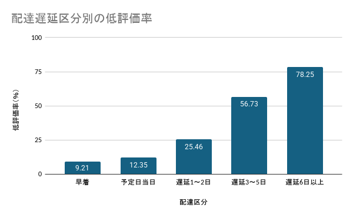
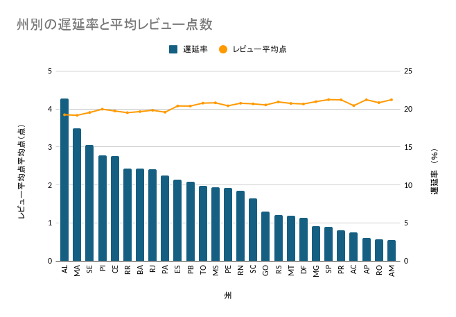
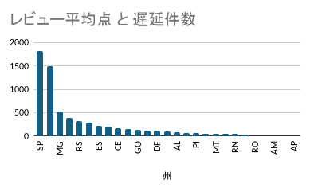

# EC取引データ分析レポート

EC取引データをSQLで集計し、課題の抽出と改善提案までを行う、個人学習を目的としたプロジェクトです。

## 1. 目的・課題設定

各種データの集計から取引実態を把握し、改善に向けた優先調査対象と施策候補を提案します。

今回は、配送遅延とレビュー評価の関係、および購入者の州別の遅延状況に着目しました。

## 2. 使用データ・環境

### 使用データ

Olistが公開しているデータセット「Brazilian E-Commerce Public Dataset by Olist」を使用しています。
出典：[Brazilian E-Commerce Public Dataset by Olist（Kaggle）](https://www.kaggle.com/datasets/olistbr/brazilian-ecommerce)

| 項目 | 内容 |
|---|---|
| 分析対象注文の購入日 | 2016年9月15日～2018年8月29日 |
| 集計単位 | 1行＝1注文 |
| 分析対象件数 | 96,386件（注文IDのユニーク件数） |
| 使用環境 | Google BigQuery・Googleスプレッドシート |

対象期間は、分析対象として抽出した注文の購入日時に基づきます。元データ全体の収録期間とは区別しています。

### 主な使用テーブル

| テーブル名 | 内容 |
|---|---|
| orders | 注文情報・注文ステータス・各種日時 |
| order_reviews | 注文に対するレビュー・評価点 |
| customers | 購入者情報・州 |

## 3. 対応内容・集計ルール

### 対応内容

- 注文ごとに最新レビューを1件採用し、1・2点を低評価と定義しました。
- 注文ステータスや日時の欠損・整合性を確認したうえで、遅延日数とレビュー評価の関係を集計しました。
- 購入者の州別に集計し、遅延率と遅延件数から優先調査地域を検討しました。
- 共通の抽出・加工処理をビューにまとめ、集計ルールを統一しました。

### 分析対象

以下の条件を満たす注文を対象としています。

- 注文ステータスが配達完了（delivered）である。
- 配達日時と配達予定日時が存在する。
- 配達日時が、購入日時・支払い承認日時・配送業者への引渡し日時より前ではない。

比較相手の日時がNULLの場合、その比較では除外していません。したがって、すべての日時の整合性が確認できたことを意味するものではありません。

### レビューの採用ルール

同じ注文に複数のレビューがある場合、以下の順に並べて先頭の1件を採用しました。

1. レビュー回答日時の降順
2. レビュー作成日時の降順
3. review_idの昇順

レビューのない注文も、分析対象の注文件数には含めています。

### 指標の定義

| 指標 | 定義 |
|---|---|
| 遅延日数 | 実配達日－配達予定日。日時を日付に変換して計算 |
| 遅延注文 | 遅延日数が1日以上の注文 |
| 有効レビュー | 評価点が1～5点のレビュー |
| 低評価 | 評価点が1点または2点のレビュー |
| 低評価率 | 低評価件数÷有効レビュー件数×100 |
| 遅延率 | 遅延注文件数÷分析対象の注文件数×100 |
| 有効レビューなし率 | （全注文件数－有効レビュー件数）÷全注文件数×100 |
| 平均レビュー点数 | レビュー点数がNULLでない注文の平均点 |

有効レビューなしには、レビュー点数のNULLと1～5点以外の値を含みます。

低評価率と遅延率では分母が異なります。遅延率の分母には、レビューのない注文も含めています。

## 4. 主な集計結果

### 4.1 遅延日数とレビュー評価の関係

| 配達区分 | 有効レビュー件数 | 低評価率（％） |
|---|---:|---:|
| 早着 | 88,083 | 9.21 |
| 予定日当日 | 1,279 | 12.35 |
| 遅延1～2日 | 1,355 | 25.46 |
| 遅延3～5日 | 1,366 | 56.73 |
| 遅延6日以上 | 3,659 | 78.25 |

有効レビューのある注文では、遅延が長い区分ほど低評価（1・2点）の割合が高い傾向が見られました。

低評価率は、予定日当日で12.35％、遅延6日以上で78.25％でした。

これは関連を示す結果であり、配送遅延の因果効果を示すものではありません。

### 4.2 州ごとの遅延率と遅延件数

分析対象96,386件のうち、遅延注文は6,533件で、全体の遅延率は6.78％でした。

全体の遅延率は、州別遅延率の単純平均ではなく、全体の遅延件数を全体の注文件数で割って算出しています。

#### 遅延率の高い順

平均レビュー点数は小数第2位まで表示しています。

| 州 | 注文件数 | レビュー平均点 | 遅延率（％） |
|---|---:|---:|---:|
| AL | 397 | 3.85 | 21.41 |
| MA | 717 | 3.83 | 17.43 |
| SE | 335 | 3.91 | 15.22 |
| PI | 476 | 3.99 | 13.87 |
| CE | 1,278 | 3.95 | 13.77 |
| RR | 41 | 3.90 | 12.20 |
| BA | 3,256 | 3.93 | 12.16 |
| RJ | 12,347 | 3.97 | 12.11 |
| PA | 946 | 3.91 | 11.21 |
| ES | 1,995 | 4.08 | 10.73 |
| PB | 517 | 4.08 | 10.44 |
| TO | 274 | 4.15 | 9.85 |
| MS | 701 | 4.16 | 9.70 |
| PE | 1,593 | 4.08 | 9.60 |
| RN | 474 | 4.15 | 9.28 |
| SC | 3,544 | 4.13 | 8.21 |
| GO | 1,957 | 4.11 | 6.54 |
| RS | 5,343 | 4.19 | 6.08 |
| MT | 886 | 4.15 | 5.98 |
| DF | 2,080 | 4.13 | 5.67 |
| MG | 11,347 | 4.19 | 4.57 |
| SP | 40,427 | 4.25 | 4.50 |
| PR | 4,920 | 4.24 | 4.04 |
| AC | 80 | 4.09 | 3.75 |
| AP | 67 | 4.24 | 2.99 |
| RO | 243 | 4.17 | 2.88 |
| AM | 145 | 4.24 | 2.76 |

棒は遅延率（右軸）、折れ線は平均レビュー点数（左軸）を示す。州は遅延率の高い順に並べている。

#### 遅延件数の多い順

| 州 | レビュー平均点 | 遅延件数 |
|---|---:|---:|
| SP | 4.25 | 1,819 |
| RJ | 3.97 | 1,495 |
| MG | 4.19 | 519 |
| BA | 3.93 | 396 |
| RS | 4.19 | 325 |
| SC | 4.13 | 291 |
| ES | 4.08 | 214 |
| PR | 4.24 | 199 |
| CE | 3.95 | 176 |
| PE | 4.08 | 153 |
| GO | 4.11 | 128 |
| MA | 3.83 | 125 |
| DF | 4.13 | 118 |
| PA | 3.91 | 106 |
| AL | 3.85 | 85 |
| MS | 4.16 | 68 |
| PI | 3.99 | 66 |
| PB | 4.08 | 54 |
| MT | 4.15 | 53 |
| SE | 3.91 | 51 |
| RN | 4.15 | 44 |
| TO | 4.15 | 27 |
| RO | 4.17 | 7 |
| RR | 3.90 | 5 |
| AM | 4.24 | 4 |
| AC | 4.09 | 3 |
| AP | 4.24 | 2 |

#### 地域別分析から読み取れること

**RJ州を優先調査の候補とする理由**

RJ州の遅延率は12.11％で、分析対象全体の6.78％を上回りました。遅延件数も1,495件と多いため、遅延率と件数の両面から優先調査する地域の候補とします。

**件数と率の使い分け**

SP州は遅延件数が1,819件と最多ですが、遅延率は4.50％で全体を下回ります。遅延件数の多さだけで配送状況が悪いとは判断せず、注文規模と遅延率を併せて評価します。

**高遅延率の地域**

AL州は遅延率21.41％、MA州は17.43％と高い結果でした。注文数や遅延件数も踏まえて、RJ州と併せて調査候補とします。

注文数が少ない州では、少数の遅延によって率が大きく変わるため、件数も確認する必要があります。

## 5. 提言

### 優先調査

RJ州向け注文について、販売者・商品構成・購入時期・配送距離などの違いを確認し、遅延が多い背景を調べます。

今回集計したのは購入者の州です。州別の結果だけで、特定の販売者や配送業者に原因があるとは判断できません。

### 配送工程の確認

購入から承認、承認から配送業者への引渡し、引渡しから配達までに分け、どの工程で時間がかかっているかを確認します。

### 改善案の検討

調査結果に応じて、出荷までの処理や配送方法、配達予定日の設定方法の見直しを検討します。

予定日を延ばすだけでは実際の配送時間の改善にならないため、予定日との差と実際の所要日数の両方を確認します。

これらは今後の調査・施策候補であり、改善効果を検証したものではありません。

## 6. 分析の限界

### 因果関係

遅延区分と低評価率の関連は確認しましたが、商品・販売者・購入時期などの影響を調整していないため、遅延の因果効果とは断定できません。

### レビューの有無

有効レビューなし率は、早着で0.54％、遅延6日以上で2.79％でした。レビューがある注文の評価が、全注文を代表するとは限りません。

### 対象範囲

今回の分析は、必要な日時が存在し、所定の日時整合性チェックを通過した配達完了注文が対象です。キャンセルや未配達を含む全注文の顧客体験を示すものではありません。

## 7. 今後の課題

販売者別の分析と、条件の違いを考慮した比較を行います。

販売者別に集計する際には、1注文に複数販売者が含まれる場合の集計ルールを決めたうえで実施します。

因果推論については、第2章で検討する予定です。

## 8. SQLの実行方法

### 事前準備

1. Olistのデータを取得します。
2. BigQueryにデータセットを作成し、必要なCSVを取り込みます。
3. 最終集計に使用するテーブル名を`orders`、`order_reviews`、`customers`とします。
4. SQL内のプロジェクトID・データセット名を、自分の実行環境に置き換えます。

本プロジェクトでは、`bq-sql-505714.olist_raw`を使用しています。

### 実行順

1. データ確認用SQLで、列定義・NULL・重複・結合関係・日時の整合性を確認します。
2. ビュー作成SQLを実行し、`v_order_delivery_review`を作成します。
3. `analysis_scope_check`を実行し、分析対象件数と購入期間を確認します。
4. `review_by_delay`を実行し、遅延区分別のレビュー状況を集計します。
5. `delivery_by_state`を実行し、購入者の州別に遅延状況を集計します。

### SQL実行後の確認ポイント

| 確認項目 | 期待値 |
|---|---:|
| 分析対象件数 | 96,386 |
| 分析対象の注文IDユニーク件数 | 96,386 |
| 有効レビュー件数 | 95,742 |
| 有効レビューなし件数 | 644 |
| 遅延注文件数 | 6,533 |

## 分析ノート

データの確認結果・SQL一覧・作業記録をまとめています。

[分析ノート（Excel）](docs/SQL_analysis_notebook.xlsx)